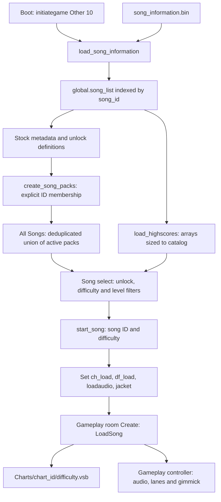

# How Vividstasis registers songs and finds playable charts

**The main song-registration entry point is `load_song_information()`.** It reads `song_information.bin` and assigns records to `global.song_list[song.song_id]`. The game then builds menu packs separately in `create_song_packs()`. Only after selecting a catalog entry and difficulty does gameplay open a `.vsb` file. Creating a folder under `Charts/` is therefore insufficient to register a new song.

This document follows the supplied build's extracted code. It identifies concrete integration points for authored charts; the example patches below have **not been installed or tested in the running game**. No game or profile files were changed during this investigation. The [VSB format specification](VSB_FORMAT.md) covers the chart contents themselves.

When the edits are ready, see the separate [patching and test-build guide](PATCHING_GAME.md) for applying GML changes with UndertaleModTool and validating a copied game build.

For new music, see [adding custom audio](CUSTOM_AUDIO.md), including the sound-resource import recipe and the playback checks still required.

## The code to start with

All source links below point into `extraction/main/CodeEntries/`.

| Source | Relevant lines | Responsibility |
| --- | --- | --- |
| [initiategame Other 10](../extraction/main/CodeEntries/gml_Object_initiategame_Other_10.gml) | 88, 108, 244–245 | Boot calls catalog loading, pack construction, then highscore/rating initialization |
| [load_song_information](../extraction/main/CodeEntries/gml_GlobalScript_load_song_information.gml) | 1–31 | Reads registry, indexes songs by numeric ID, fills holes, sets sorting metadata |
| [getGenericSong](../extraction/main/CodeEntries/gml_GlobalScript_load_song_information.gml) | 133–183 | Complete default song struct and default unlock policy |
| [V1VSDReader](../extraction/main/CodeEntries/gml_GlobalScript_v1_vsd_reader.gml) | 22–86 | Decodes registry records and resolves audio/jacket/preview resources |
| [create_song_packs](../extraction/main/CodeEntries/gml_GlobalScript_create_song_packs.gml) | 356–383 | Converts named pack definitions into menu packs and builds their All Songs union |
| [process_song_unlocks](../extraction/main/CodeEntries/gml_GlobalScript_process_song_unlocks.gml) | 10–91 | Builds four difficulty-unlock flags per catalog slot |
| [refresh_song_objects](../extraction/main/CodeEntries/gml_GlobalScript_refresh_song_objects.gml) | 23–94, 240–253 | Turns the selected pack into visible song/difficulty entries |
| [normal song-select controller](../extraction/main/CodeEntries/gml_Object_o_songselect_main_Create_0.gml) | 24, 53, 252–257 | Refreshes unlock/menu state; confirms with `start_song(id, difficulty)` |
| [start_song](../extraction/main/CodeEntries/gml_GlobalScript_start_song.gml) | 4, 32–95, 98–155 | Resolves song metadata, difficulty basename, audio, and gameplay room |
| [scene_gameplay room Create](../extraction/main/CodeEntries/gml_Room_scene_gameplay_Create.gml) | 1 | Calls `LoadSong(global.ch_load, global.df_load)` |
| [LoadSong](../extraction/main/CodeEntries/gml_GlobalScript_LoadSong.gml) | 3, 7, 92–100 | Opens the VSB, builds lanes/timing data, creates the gameplay controller |

The decisive registration operation is:

```gml
var songList = read_binary_vsd("song_information.bin", true);
for (var h = 0; h < array_length(songList); h++) {
    var song = songList[h];
    global.song_list[song.song_id] = song;
}
```

The decisive chart lookup is:

```gml
read_binary_chart($"{working_directory}Charts/{arg0}/{arg1}.vsb");
```

Here `arg0` is the catalog's `chart_id`, and `arg1` is the selected difficulty basename.

## End-to-end path



There are three different identities to keep separate:

| Identity | Example | Used for |
| --- | --- | --- |
| `song_id` | Numeric catalog slot | Packs, unlock arrays, score arrays, progression, leaderboard identity |
| `chart_id` | `tutorial`, or a future `custom_demo` | Chart directory and asset-name suffix |
| Difficulty | Numeric `0`, basename `OPENING`, metadata suffix `_1` | Which chart file and metadata/score slot to select |

The VSB itself does not register any of these identities.

## 1. Catalog loading: `song_information.bin`

[read_binary_vsd](../extraction/main/CodeEntries/gml_GlobalScript_read_binary_vsd.gml) accepts the five-byte header `56 53 44 01 00`: **`VSD`, version 1, zero reserved byte**. This is distinct from the chart's `VSC` header.

The registry contains tagged song records:

```text
56 53 44 01 00
repeat songs:
    A0                                      song start
    repeat metadata or difficulty records:
        A2 <type:u8> <field_id:u8> <value>   metadata field
        C0 <display:stringz> <constant:f32> <designer:stringz>
    A1                                      song end
FF                                          registry end
[384-byte signature]
```

There is no song-count field. Numeric values are little endian; strings are UTF-8 bytes through a NUL terminator. Four positional `C0` records are emitted by the current writer, in OPENING/MIDDLE/FINALE/ENCORE order.

### Registry metadata fields

[vsd_enums](../extraction/main/CodeEntries/gml_GlobalScript_vsd_enums.gml) defines the field-index table. The byte named `hash` in the reader is an **array index**, not a hash of the text key.

| Index | Name | Canonical type | Meaning |
| --- | --- | --- | --- |
| 0 | `song_id` | `B2`: `u32` | Numeric catalog/score identity |
| 1 | `name` | `B8`: `stringz` | Song title; also participates in hardcoded gameplay-room choices |
| 2 | `formatted_name` | `B8`: `stringz` | Formatted display title |
| 3 | `artist` | `B8`: `stringz` | Artist metadata |
| 4 | `chart_id` | `B8`: `stringz` | Chart folder and resource suffix |
| 5 | `bpm_display` | `B8`: `stringz` | Numeric text used for display and initial timing BPM |
| 6 | `version` | `B8`: `stringz` | Dot-separated numeric version for sorting |
| 7 | `has_encore` | `B7`: one-byte boolean | Whether the fourth normal difficulty exists |
| 8 | `is_original` | `B7`: one-byte boolean | Original-song metadata |
| 9 | `jacket_artist` | `B8`: `stringz` | Jacket credit |
| 10 | `is_published` | `B7`: one-byte boolean | Writer's optional publication filter |

`B7` is a one-byte boolean: the mapper returns GameMaker buffer type **10**, `buffer_bool`. Type **9** is `buffer_f64`; it is not selected by this mapper. This corrects the earlier draft of the VSB specification, parser, and pattern. All shipped VSB extras use `B3` or `B6`, so their recovered data was unaffected; the corrected pattern was revalidated on all 805 charts and boolean synthetic fixtures.

`is_published=false` is not a menu-hiding mechanism. The [writer](../extraction/main/CodeEntries/gml_GlobalScript_v1_vsd_writer.gml), lines 34–37, can omit unpublished records when `publishedOnly` is enabled; the reader inserts every record actually present without checking this flag.

### Difficulty metadata

Each `C0` record serializes a display string, four-byte difficulty constant, and designer string. The reader then **discards the stored display string** and recomputes it from the constant: floor the constant, and append `+` when the rounded tenths digit is at least five. The first through fourth records populate:

```text
difficulty_constant_1 .. difficulty_constant_4
 difficulty_display_1 ..  difficulty_display_4
      note_designer_1 ..       note_designer_4
```

Defaults come from `getGenericSong(0)`: descriptive fields `N/A`, `chart_id="generic"`, `bpm_display="120"`, false flags, zero constants, display `"0"`, and default unlock information. Real records should supply an explicit unique ID and chart ID rather than inheriting these placeholder identities.

### What exists in this distribution

The [decoded inventory](../analysis/chart_registration/registry_inventory.json) contains all **203 registry records**, with four difficulty records each, and exact typed fields/offsets. IDs run from 1 through 206, with 2, 145, and 185 absent from the binary. Both numeric IDs and chart IDs are unique. All 203 records have `is_published=true`.

The decoder re-encoded the entire file byte for byte and verified its RSA signature. The loader fills missing array slots with `getGenericInvalidSong()`, which starts locked and hidden. A gap in the binary is **not evidence that the ID is safe to reuse**: other code contains hardcoded song IDs, unlock assignments, and story behavior.

## 2. Audio, jackets and previews are separate resource registrations

After reading each registry record, `V1VSDReader` derives these GameMaker asset names:

```text
main audio: music_chart_<chart_id>
jacket:     song_<chart_id>
preview:    preview_<chart_id>
```

It resolves them with `asset_get_index()`. These are registered resource names from the compiled game data, **not loose filenames**. Dropping `custom_demo.ogg` or `custom_demo.png` beside a VSB does not satisfy this lookup.

| Resource missing | Loader behavior |
| --- | --- |
| Main audio | Logs a warning; leaves ID `-1`, with no generic song-audio fallback |
| Jacket | Uses `song_generic` |
| Preview | Uses `preview_generic` |

All 203 expected main-audio resource names exist in the extracted sound table. Tutorial lacks its specifically named jacket/preview resources and uses the fallbacks. Resource-name presence does not by itself prove the backing audio payload/group is available.

A new track therefore needs either a sound resource registered in a modified `data.win`, with valid audio payload/group references, or an explicitly designed audio-loading patch. Do not assume a generic external streaming handle works with the existing native precise-audio extension: [cc Create](../extraction/main/CodeEntries/gml_Object_cc_Create_0.gml), lines 59–67, passes the selected audio ID to either GameMaker audio or `precise_audio_load_sound()`.

The simplest first custom **chart** can reuse an existing song's registered audio. Adding entirely new music is a later asset-integration step.

## 3. Post-load metadata, unlocks and score arrays

The catalog is enriched by `load_song_information()` after insertion:

- It fills ID holes and initializes `sort_artists`.
- It builds the initial daily-boost candidate list from IDs `3..183`, then selects daily boosts.
- It applies backstages, preludes, unlock definitions, collaboration origins, story-specific jacket overrides, and `artists.vsd` credits/sort overrides.

The [unlock-definition builder](../extraction/main/CodeEntries/gml_GlobalScript_create_unlockable_songs.gml), lines 422–453, can extend the catalog with invalid placeholders, then override entries and append hardcoded IDs to `global.valid_song_ids`. This list is not the general catalog and is not required by `refresh_song_objects()` to display a pack member. Adding a custom song to it would not retroactively rerun the day's already-performed boost selection.

`process_song_unlocks()` later iterates the entire catalog and builds `global.unlocked_songs[id][difficulty]`. The generic unlock policy has `type=0`, `enc_type=0`, `per_difficulty=false`, `hidden=false`; absent `locked` is treated as false. That policy sets all four unlock flags true; `has_encore=false` still keeps the fourth difficulty out of normal selection. Actual stock unlock overrides can replace it, and Encore gets additional stock policy where applicable.

[load_highscores](../extraction/main/CodeEntries/gml_GlobalScript_load_highscores.gml), lines 26–35, iterates the catalog length and allocates five normal score records per slot. **Register new entries before score and menu initialization.** Late insertion without rebuilding dependent arrays leaves the selector/results code indexing missing data. A complete hot-reload feature would need explicit state rebuilding; it does not exist just because the VSB is an external file.

The preferred initial patch point for an injected custom record is the **end of `load_song_information()`, after `file_text_close(artists_file)` at line 120 and before its closing brace**. This avoids stock postprocessing overriding the custom entry while still preceding boot's pack and highscore initialization. Use `getGenericSong(new_id)` and explicitly set `sort_artists`, assets, descriptive fields, and difficulties for the injected record.

## 4. Packs are what make a song selectable

`create_song_packs()` defines explicit numeric song-ID arrays for story chapters, collaborations, tournaments, and other packs. Shop Collection is populated from `global.store_songs`, not arbitrary catalog entries. Active packs depend on story/profile state and the function's mode argument.

At lines 356–359, the selected pack names are replaced by their pack structs. At lines 360–383, **All Songs is built by deduplicating the IDs from those active packs**. It does not iterate `global.song_list`, and it does not enumerate directories.

For an independent custom entry, add a dedicated pack **after the pack-name-to-struct conversion and before `var all_songs = []`**. This causes the normal union code to include the custom ID in All Songs too. Make the insertion part of the pack-building function so it survives later rebuilds. Restrict it to normal mode (`arg0 == -1`) if it should not appear in the hardcoded boss playlists.

`refresh_song_objects()` then iterates only the selected pack's IDs. It applies hidden/unlock state, Encore visibility, selected difficulty range, level range, artist grouping and sort order. Consequently:

| Symptom | Likely missing stage |
| --- | --- |
| Folder exists, no catalog entry | Registry/injection |
| Catalog entry exists, absent even from All Songs | Pack membership |
| Entry only appears with some filters | Difficulty/level/artist filter state |
| Entry is hidden or cannot confirm | Hidden flag or per-difficulty unlock state |
| Entry appears, preview/jacket generic | Missing named assets, using designed fallbacks |
| Entry appears, gameplay audio fails | Unresolved/incompatible main audio resource or payload |
| Entry appears, chart load fails | Missing/malformed VSB at selected path |

The first three difficulties are not automatically hidden by checking whether their VSB files exist. Normal confirmation also constructs difficulty options from metadata and unlocks. Its optional `allowed_difficulties` field restricts confirmation choices ([new confirmation Create](../extraction/main/CodeEntries/gml_Object_o_songselect_newconfirm_Create_0.gml), lines 124–155), but the main list does not generally use that field to suppress all missing-file entries. For a first independent entry, provide OPENING, MIDDLE and FINALE files, or explicitly implement availability filtering in both menu stages.

## 5. Selection becomes a chart path

The normal selector confirms with `start_song(selected_song.song_id, selected_difficulty)`. That function sets `global.song_id_last`, `global.ch_load`, `global.df_load`, `global.loadaudio`, and `global.loadjacket` from the chosen record.

| Difficulty argument | VSB basename | Metadata suffix |
| --- | --- | --- |
| `0` | `OPENING` | `_1` |
| `1` | `MIDDLE` | `_2` |
| `2` | `FINALE` | `_3` |
| `3` | `ENCORE` | `_4` |
| `4` | `PRELUDE` | `_5` |

The normal list cycles only 0–3. PRELUDE metadata is added separately by [create_song_preludes](../extraction/main/CodeEntries/gml_GlobalScript_create_song_preludes.gml); SHATTER uses a separate [hardcoded catalog](../extraction/main/CodeEntries/gml_GlobalScript_create_shatter_list.gml) and launch route. A `SHATTER.vsb` or `PRELUDE.vsb` alone does not create a new normal selector difficulty.

ENCORE can use `enc_data` to override audio, title, artist and jacket through [song_get_info](../extraction/main/CodeEntries/gml_GlobalScript_song_get_info.gml). The file still uses the song's base `chart_id` plus `ENCORE.vsb`. BACKSTAGE is an Encore presentation/metadata path, not automatically a `BACKSTAGE.vsb` lookup in `start_song()`.

Ordinary songs go to `scene_gameplay`; several exact song names select special rooms. Gameplay's room Create calls `LoadSong()`, which opens:

```text
<working_directory>/Charts/<catalog.chart_id>/<difficulty_basename>.vsb
```

Use the exact basenames/case shown above. Some older/story selectors show a friendly missing-file message, but `start_song()` and `LoadSong()` do not themselves supply that guard. Stats loading tolerates missing files; that does not make them playable.

The gameplay controller uses the selected audio ID and the lanes/mods decoded from the VSB. Charts with modifiers also resolve the configured gimmick object's compiled asset and registered methods. A simple first chart can omit modifiers. Include playable notes; the controller derives scoring values by dividing by note count.

## Two practical routes toward our own charts

### Route A: authored notes for an existing song

This is the smallest end-to-end experiment:

1. In a separate test installation/profile, choose an unlocked ordinary song and a standard difficulty.
2. Preserve its original VSB, then place the authored VSB at the existing `Charts/<chart_id>/<difficulty>.vsb` path.
3. Reuse the registered audio and existing metadata. Match chart timestamps to that audio; an explicit BPM event at time zero makes the intended timing grid clear.
4. The stats checksum mismatch causes regeneration; a hand-authored `.stats` is not required.
5. Select the existing song/difficulty normally, or use a purpose-built test launch that bypasses stock results handling.

This route tests our VSB writer and timing without requiring new audio or catalog integration. It keeps the original song's score identity unless the results path is changed.

### Route B: a separate custom entry, initially reusing existing audio

There are two ways to supply its catalog record: add a VSD record in `song_information.bin`, or inject a complete struct in `load_song_information()`. Both still require pack membership. An injected entry can explicitly reuse an existing asset ID; the unmodified VSD reader instead insists on the `music_chart_<chart_id>` naming convention.

The following is an **uninstalled example** for the end-of-loader hook described above. It reuses Tutorial's existing audio while giving the chart its own folder and numeric ID:

```gml
// Insert inside load_song_information(), after file_text_close(artists_file).
// This is an example for one local test entry, not an installed mod.
var base_song = global.song_list[1]; // Existing Tutorial audio.
var custom_id = getNewSongId();
var custom = getGenericSong(custom_id);
custom.name = "Custom Chart Test";
custom.formatted_name = custom.name;
custom.artist = base_song.artist;
custom.chart_id = "custom_demo";
custom.audio_id = base_song.audio_id;
custom.preview_id = base_song.preview_id;
custom.jacket = base_song.jacket;
custom.jacket_artist = base_song.jacket_artist;
custom.bpm_display = base_song.bpm_display;
custom.version = "6.2.2"; // Numeric components: version sorting calls real().
custom.has_encore = false;
custom.is_published = true;
custom.invalid = false;
custom.sort_artists = [custom.artist];
custom.is_custom_chart = true; // Our proposed marker, not a stock feature.
for (var slot = 1; slot <= 3; slot++) {
    struct_set(custom, $"difficulty_constant_{slot}", 4.0);
    struct_set(custom, $"difficulty_display_{slot}", "4");
    struct_set(custom, $"note_designer_{slot}", "Your Name");
}
global.song_list[custom_id] = custom;
global.custom_chart_song_id = custom_id;
```

`getGenericSong(custom_id)` supplies a default unlocked policy with the correct `unlock.song_id`. The display values above are explicit because this injected object does not pass through the VSD reader's display recomputation. The `_4` fields retain defaults and Encore is disabled.

Provide valid charts under:

```text
Charts/custom_demo/OPENING.vsb
Charts/custom_demo/MIDDLE.vsb
Charts/custom_demo/FINALE.vsb
```

For a first registration test these can be copies of the same authored chart. They should use the reused Tutorial audio's timing. No `.stats` files are required to register the entry.

Then insert this second example inside `create_song_packs()`, **after its line-356 conversion loop and before line 360's `var all_songs = []`**:

```gml
if (arg0 == -1 && variable_global_exists("custom_chart_song_id")) {
    array_push(global.song_packs, {
        name: "Custom Charts",
        songs: [global.custom_chart_song_id],
        color1: 16777215,
        color2: 16724480,
        description: "Local authored charts."
    });
}
```

The existing All Songs union now includes that ID, subsequent boot score-array initialization sees it, and normal menu unlock processing sees the generic unlocked policy. `global.valid_song_ids` is not needed for this pack path. For a multi-song implementation, replace the single variable with a stable custom manifest and an array of IDs.

`getNewSongId()` returns one more than the largest current slot's declared ID. The registry currently tops out at 206, but reserve persistent IDs deliberately when building a real multi-song mode: assigning IDs by changing file-enumeration order would change score identity between runs. Do not reuse the observed registry gaps without auditing their hardcoded uses.

To use original new music later, import/register its sound payload and either keep direct injected IDs or adopt the VSD naming convention. Jacket and preview can initially use the generic assets. A folder-based custom-song manifest/importer would be new functionality we add; it is not present in this catalog path.

## Results and testing identity

The existing result pipeline treats authored notes as the selected song/difficulty. [Results Create](../extraction/main/CodeEntries/gml_Object_o_2023results_Create_0.gml), lines 133–140, submits a chart score and updates score records when `!global.op_autoplay`. The [upload helper](../extraction/main/CodeEntries/gml_GlobalScript_upload_score.gml), lines 8–12, names that leaderboard:

```text
song_leaderboard_<song_id>_<chart_id>_<difficulty>
```

Custom registration does not itself disable stock rating/profile/network processing. A local authoring mode should explicitly separate custom score storage and skip stock chart-score/rating submissions. Autoplay suppresses the shown chart-score update branch, but the same results object still calls the rating upload helper outside that branch; autoplay is not a general no-network switch.

`start_song()` supports `actually_skip_results=true`. The shown clear/fail paths use it to route to the configured return room rather than the results room ([cc Step](../extraction/main/CodeEntries/gml_Object_cc_Step_1.gml), lines 238–260; [failure menu](../extraction/main/CodeEntries/gml_Object_o_lifedepleted_Create_0.gml), line 19). An example test launch after normal initialization is:

```gml
start_song(global.custom_chart_song_id, 0, {
    gameplay_room: scene_gameplay,
    clear_room: scene_songselect_old,
    fail_room: scene_songselect_old,
    quit_room: scene_songselect_old,
    actually_skip_results: true
});
```

This is an internal GML call, not a supported executable command-line option. `skip_results=true` alone does not bypass creation of the results object or its score code.

The `force_chart` option only replaces the basename, retaining the catalog folder/audio. A nonstandard basename such as `CUSTOM` also falls into the results screen's default Shatter-score branch. Keep a standard basename for the first implementation, or build a complete custom results route. The legacy `force_load_song()` still indexes the catalog for jacket/BPM and omits some `start_song()` initialization; it is not a standalone arbitrary-file chart loader.

## Reproducing the static registry audit

```bash
python tools/song_registry.py vividstasis/song_information.bin \
  --assets extraction/main/metadata/asset_index.csv \
  --output analysis/chart_registration/registry_inventory.json
```

The tool records typed metadata, record offsets, derived displays, expected resource names, duplicate-ID checks, source SHA-256, signature status, and byte-identical re-encoding. It does not sign changed registries or install them. The supplied build's `rsa_verify()` bypass applies to both VSB and VSD readers; modified unsigned files should not be assumed compatible with other builds.

The next implementation boundary is now concrete: an authored VSB plus either an existing playable slot, or **a registered song struct + usable audio + pack membership + initialized unlock/score state**. The latter needs two code integration points even when its binary chart is already valid.
